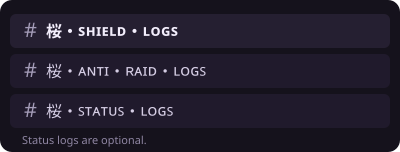

<div align="center">



</div>

<br />

Shield is a private security bot for Discord. It watches every change made to a server, removes the roles of anyone who breaks the rules, throws out bots nobody approved, and keeps banned accounts banned.

**Shield is not public.** To add it to your server, message **`meatforlove`** on Discord.



## What it stops <sub>防御</sub>

| If someone… | Shield… |
| --- | --- |
| Creates, deletes or edits a channel | Removes their roles |
| Creates, deletes or edits a role | Removes their roles |
| Changes any server setting | Removes their roles and pings `@here` |
| Changes channel settings or permissions | Removes their roles and pings `@here` |
| Gives someone an admin role | Takes the role back and removes the giver's roles |
| Bans or kicks with right-click instead of Shield | Removes their roles |
| Adds a bot nobody approved | Kicks the bot and removes the inviter's roles. Pings `@here` if Discord has not verified the bot |
| Makes an invite that hands out dangerous roles | Deletes the invite |

**Anti-nuke** counts fast actions twice: per person, and across the whole server. Three deletions in two seconds trip it, even if three different accounts delete one channel each. Trusted people are not exempt. When it trips, Shield removes the attackers' roles and strips dangerous permissions from the shared roles they used, then pings `@here`.

**Locked roles.** A protected role given by someone Shield cannot confirm is removed straight away. If Discord then confirms the giver was allowed, Shield gives it back.





## Access <sub>権限</sub>

Only the bot owner, the server owner and Operators can use Shield. Each list takes people or roles.

| Level | What it allows |
| --- | --- |
| **Guard** | Create and delete channels, create non-admin roles, delete roles, give existing roles, right-click ban and kick. Cannot create admin roles or change settings. |
| **Sentinel** | Every server action. Still caught by anti-nuke, locked roles and invite protection. |
| **Operator** | Use Shield's commands. Gives no protection on its own. |

`+whitelist list` shows all three in one list, with names and IDs.



## Void <sub>追放</sub>

A Void is a ban that stays. If someone unbans the account by hand, Shield bans it again. If the account comes back, Shield bans it again. Only `unvoid` clears it.

```text
void @user reason        +void 1199052837461029376 reason
unvoid @user reason      +unvoid 1199052837461029376
voidlist                 +void list
```

These three work with or without the prefix, with a mention or a user ID.



## Setup <sub>設定</sub>

`+setup` opens a paged panel. Pick the two log channels, add people to Guard, Sentinel and Operator, lock roles, tune protection, and change the prefix for the whole server or for any single command. Protection stays off until you turn it on.



## Logs <sub>記録</sub>

Shield renames the two channels you pick:



- **Shield logs** get every audit entry and server event in plain text. No pings.
- **Anti-raid logs** get styled alerts. `@here` only for setting changes, anti-nuke and unverified bots.



## Commands <sub>コマンド</sub>

| Command | Who |
| --- | --- |
| `+setup` · `+prefix` | Owner |
| `+whitelist list` · `+whitelist add/remove` | List: Operators. Changes: owner |
| `+cold list` · `+cold add/remove` | List: Operators. Changes: owner |
| `+ban` · `+unban` · `+kick` | Operators |
| `void` · `unvoid` · `voidlist` | Operators |
| `+protection` · `+emergency` | Status: Operators. Changes: owner |
| `+help` · `+ping` · `+status` · `+support` | Operators |

## Limits <sub>制限</sub>

- Discord does not show bots IP addresses, so there are no IP bans. Void works by account.
- Shield reacts after Discord reports an action. It cannot bring back a deleted channel.
- Shield cannot touch the server owner or anyone whose role is above its own.
- Each server keeps its own settings, lists and Voids. Shield only works in servers its owner approves.

## Add Shield <sub>依頼</sub>

Shield is set up by hand for each server. Message **`meatforlove`** on Discord.

<sub>This repository holds documentation and demo images only. The bot's source code and server data are private. The images use made-up names and IDs.</sub>


